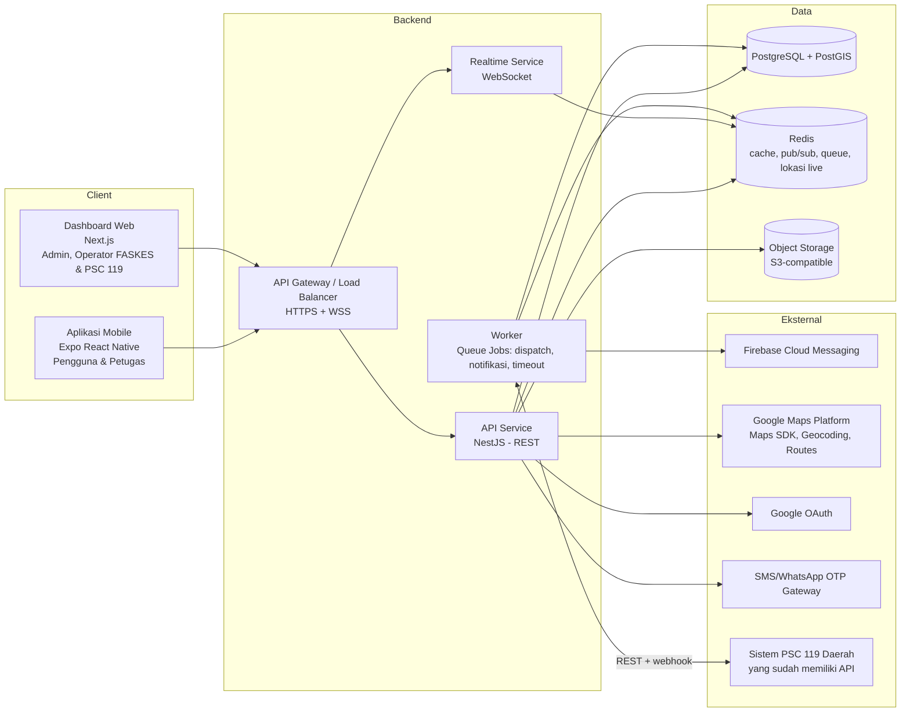
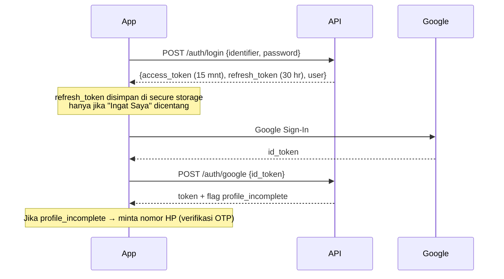
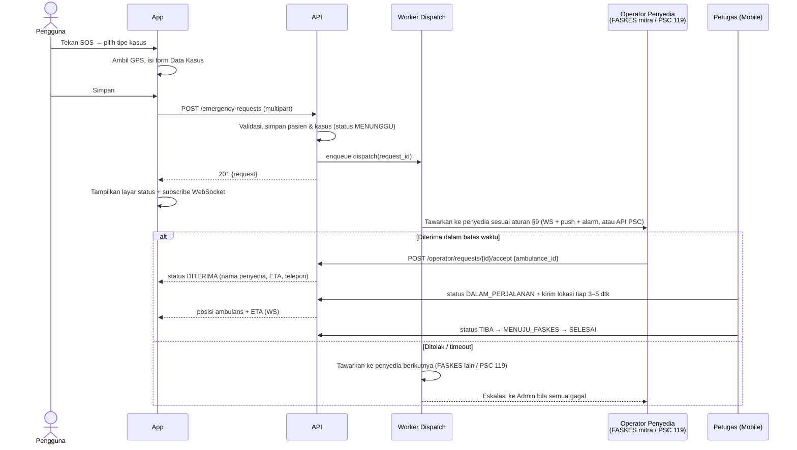
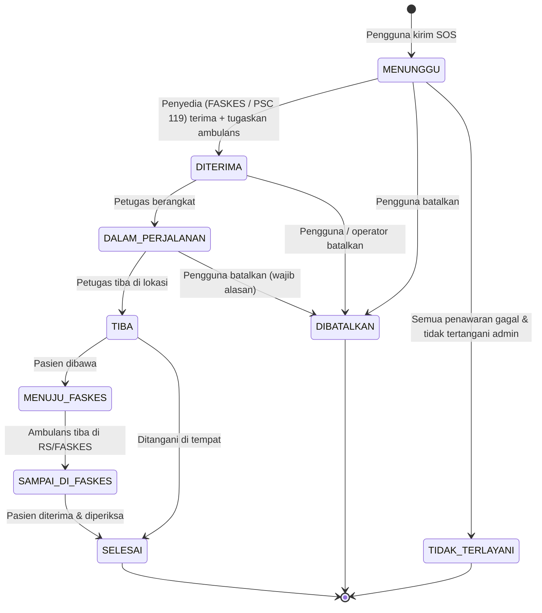
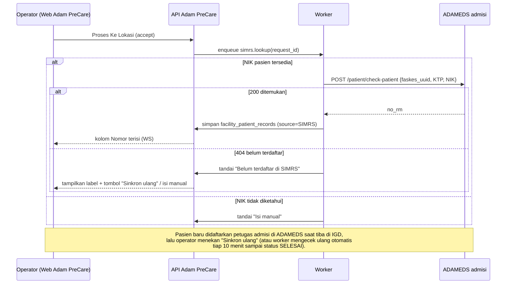

# Desain Sistem — Adam PreCare

> Dokumen rancangan sistem untuk aplikasi **Adam PreCare** (layanan permintaan ambulans darurat & informasi fasilitas kesehatan).
> Disusun berdasarkan mockup Figma di `docs/mobile/` (Login, Home, Pasien, Lokasi, Profile) dan `docs/web/` (Login, dashboard, DATA KASUS MASUK, tracking ambulance, laporan, Profile). Bagian yang tidak ada di mockup ditandai sebagai **usulan**.

| Atribut | Nilai |
|---|---|
| Versi dokumen | 1.3 (draft) — nama produk, sumber No. RM, arti status "Diperiksa" ditetapkan |
| Tanggal | 12 Oktober 2026 |
| Status | Usulan — perlu review tim produk & engineering |
| Keputusan yang sudah ditetapkan | Nama produk: **Adam PreCare** · Penyedia ambulans: **FASKES mitra + PSC 119 daerah** · Backend: **NestJS** · Warna & font: **§12** · No. RM: **manual atau SIMRS** · "Diperiksa" = **akhir layanan** |

---

## Daftar Isi

1. [Ringkasan Produk](#1-ringkasan-produk)
2. [Aktor & Peran](#2-aktor--peran)
3. [Pemetaan Mockup ke Fitur](#3-pemetaan-mockup-ke-fitur)
4. [Arsitektur Sistem](#4-arsitektur-sistem)
5. [Alur Bisnis Utama](#5-alur-bisnis-utama)
6. [Model Data](#6-model-data)
7. [Desain API](#7-desain-api)
8. [Realtime & Notifikasi](#8-realtime--notifikasi)
9. [Dispatch Ambulans](#9-dispatch-ambulans)
10. [Keamanan & Privasi Data](#10-keamanan--privasi-data)
11. [Kebutuhan Non-Fungsional](#11-kebutuhan-non-fungsional)
12. [Design System (UI)](#12-design-system-ui)
13. [Koreksi & Layar Tambahan dari Mockup](#13-koreksi--layar-tambahan-dari-mockup)
14. [Rencana Rilis Bertahap](#14-rencana-rilis-bertahap)
15. [Keputusan Terbuka](#15-keputusan-terbuka)

---

## 1. Ringkasan Produk

Adam PreCare memungkinkan masyarakat:

1. **Meminta ambulans darurat (SOS)** dengan memilih jenis kasus, mengisi data pasien, lokasi, deskripsi, dan foto.
2. **Melacak ambulans** secara realtime sampai tiba di lokasi.
3. **Mengelola data pasien** yang pernah dilaporkan.
4. **Mencari fasilitas kesehatan (FASKES)** terdekat beserta poliklinik yang tersedia dan membuka rutenya di Google Maps.
5. **Membaca artikel kesehatan.**

Agar alur SOS bisa berjalan, sistem juga membutuhkan sisi **penyedia layanan** serta **admin** yang tidak ada di mockup, tetapi wajib ada di sistem (lihat §2 dan §4).

Ambulans disediakan oleh **dua jenis penyedia**:

| Jenis penyedia | Contoh | Cara terhubung |
|---|---|---|
| **FASKES mitra** | Rumah sakit, klinik, puskesmas yang bekerja sama | Dashboard web Adam PreCare + aplikasi petugas |
| **PSC 119 daerah** (Public Safety Center Dinkes kab/kota) | PSC 119 Surabaya, PSC 119 Kab. Magelang | Dashboard web Adam PreCare, **atau** integrasi API bila PSC daerah tersebut sudah punya sistem sendiri |

Bagi pengguna keduanya terlihat sama: layar Lacak menampilkan nama penyedia (mis. "RS Sehat Sentosa" atau "PSC 119 Kota Surabaya"), estimasi waktu tiba, dan tombol Telpon.

---

## 2. Aktor & Peran

| Aktor | Kanal | Tanggung jawab | Ada di mockup? |
|---|---|---|---|
| **Pengguna (Pelapor)** | Aplikasi mobile | Login, kirim SOS, lacak ambulans, kelola pasien, lihat FASKES & artikel | ✅ Ya |
| **Operator FASKES** | Dashboard web | Menerima/menolak permintaan, menugaskan ambulans, memantau ambulans, melihat laporan & statistik, mengelola profil & poliklinik FASKES | ✅ Sebagian (`docs/web/`: Dashboard, Data Kasus Masuk, Tracking, Laporan, Profil) |
| **Operator PSC 119** | Dashboard web (atau sistem PSC sendiri via API) | Sama seperti operator FASKES, untuk kasus di wilayahnya | ✅ Memakai layar web yang sama |
| **Petugas Ambulans** | Aplikasi mobile (mode petugas) | Mengirim lokasi GPS, memperbarui status (berangkat → tiba → selesai), melihat detail kasus. Berlaku untuk petugas FASKES mitra maupun PSC 119. | ❌ Usulan |
| **Admin Sistem** | Dashboard web | Kelola penyedia (FASKES & PSC 119), ambulans, akun, artikel, banner, FAQ/kebijakan, versi aplikasi, monitoring & eskalasi | ⚠️ Hanya peran "Super Admin" di layar Profil; menu manajemen belum ada (usulan) |

> **Catatan:** Tanpa aplikasi/mode petugas, fitur "Lacak Ambulance" pada mockup tidak bisa menampilkan posisi nyata. Usulan: satu aplikasi mobile (Expo) dengan **mode berbasis peran** (role `CREW` menampilkan UI petugas), agar tidak perlu dua aplikasi terpisah di tahap awal.

---

## 3. Pemetaan Mockup ke Fitur

### 3.1 Autentikasi — `Login.png`

| Layar | Elemen | Kebutuhan sistem |
|---|---|---|
| Splash | Animasi lingkaran merah → logo | Cek token tersimpan → arahkan ke Beranda atau Login. Cek versi minimum aplikasi (force update). |
| Login | Email/No. Telepon, Password, Ingat Saya, Lupa Password, Masuk, Buat Akun, Akun Google | `POST /auth/login` (identifier = email **atau** nomor HP), Google Sign-In (`POST /auth/google`). "Ingat Saya" = simpan refresh token di secure storage; jika tidak dicentang, sesi berakhir saat aplikasi ditutup. |

### 3.2 Beranda & SOS — `Home.png`

| Layar | Elemen | Kebutuhan sistem |
|---|---|---|
| Beranda (normal) | Sapaan nama, carousel banner, tombol **SOS**, kartu "Lokasi Anda Saat Ini", daftar Artikel + "Lainnya" | `GET /me`, `GET /banners`, `GET /articles`, reverse geocoding lokasi perangkat. |
| Pilih tipe kasus | Kecelakaan, Nyeri Dada, Sesak Nafas, Bencana Alam, Lainnya | Master data `case_types` (dikelola admin, bukan hardcode). |
| Data Kasus | Identitas*, tombol "Data Diri Sendiri", Nama Pasien*, Lokasi*, "Pilih Lokasi Saat Ini", Deskripsi*, Foto (Camera/Gallery), Simpan | `POST /emergency-requests` (multipart). "Data Diri Sendiri" mengisi otomatis dari profil pengguna. |
| Konfirmasi | "Ambulans dan petugas sedang dalam perjalanan", Lacak Ambulance, Batalkan Permintaan | Teks dibuat **dinamis mengikuti status** (lihat §5.3). `POST /emergency-requests/{id}/cancel`. |
| Lacak Ambulance | Peta + rute, nama RS, estimasi waktu tiba, Telpon, Batalkan | WebSocket posisi ambulans, ETA dari layanan routing, nomor telepon penyedia/petugas. Nama di kartu = nama penyedia (FASKES mitra atau "PSC 119 {wilayah}"). Bila PSC terintegrasi via API tanpa data GPS, peta hanya menampilkan lokasi kejadian + status & ETA dari PSC. |
| Beranda (permintaan aktif) | Kartu "Ambulan Sedang Dalam Perjalanan" menggantikan tombol SOS | `GET /emergency-requests/active`. Satu pengguna hanya boleh punya **1 permintaan aktif**. |

### 3.3 Pasien — `Pasien.png`

Dari mockup terlihat dua kondisi kartu di List Pasien: **"- Tahun / -"** lalu **"20 Tahun / Laki-laki"**. Ini konsisten dengan alur berikut:

1. Saat SOS, form Data Kasus **tidak** meminta Umur & Jenis Kelamin (agar cepat) → pasien tersimpan dengan umur & jenis kelamin kosong.
2. Setelah itu pengguna dapat melengkapi data di layar **Data Pasien** (ada Umur & Jenis Kelamin).

Jadi perbedaan kedua form **disengaja dan dipertahankan**: form SOS = minimal, form Data Pasien = lengkap.

| Layar | Kebutuhan sistem |
|---|---|
| List Pasien | `GET /patients` — nama, nomor identitas, umur, jenis kelamin. |
| Data Pasien | `GET /patients/{id}`, `PATCH /patients/{id}`. Judul "Kecelakaan" pada mockup = tipe kasus terakhir pasien tersebut; foto & deskripsi berasal dari kasus terkait. |

### 3.4 Lokasi FASKES — `Lokasi.png`

| Layar | Kebutuhan sistem |
|---|---|
| Daftar FASKES | `GET /facilities?lat=&lng=` — diurutkan berdasarkan jarak, berisi foto, nama, alamat, jarak (km), telepon. Pagination. |
| Detail FASKES | `GET /facilities/{id}` — foto, jarak, telepon (tap = panggil), alamat, daftar poliklinik, tombol Google Maps (deep link `https://www.google.com/maps/dir/?api=1&destination=lat,lng`). |

### 3.5 Profil — `Profile.png`

| Menu | Kebutuhan sistem |
|---|---|
| Kartu pengguna | Nama + nomor identitas/telepon dari `GET /me`. |
| Edit Profile | `PATCH /me` (nama, NIK, tanggal lahir, jenis kelamin, telepon, foto). |
| Ubah Password | `POST /me/password`. Untuk akun Google tanpa password → tampilkan "Buat Password". |
| FAQ, Kebijakan Privasi, Syarat dan Ketentuan | `GET /pages/{slug}` (konten dikelola admin). |
| Info Update | `GET /app-versions/latest?platform=` (catatan rilis). |
| Keluar + dialog konfirmasi | `POST /auth/logout` (cabut refresh token & hapus token FCM perangkat). |

### 3.6 Dashboard Web — `docs/web/`

Dashboard dipakai oleh **operator penyedia** (FASKES mitra / PSC 119). Badge di footer kanan ("RS SEHAT SENTOSA") menunjukkan penyedia milik operator yang sedang login. Semua data di dashboard otomatis dibatasi ke penyedia tersebut.

**Kerangka halaman (semua layar setelah login):**

| Elemen | Kebutuhan sistem |
|---|---|
| Header: logo, ikon lonceng dengan badge, avatar dengan titik status online | Lonceng = notifikasi kasus baru/pembatalan (WebSocket `facility:{id}`), badge = jumlah belum dibaca. Titik hijau = koneksi realtime aktif. |
| Menu avatar: nama akun, badge peran, Profile, Logout | `GET /me`, `POST /auth/logout` |
| Sidebar "Menu" (dapat diciutkan): Dashboard, Data Kasus Masuk, Tracking Ambulance, Laporan | Menu ditampilkan sesuai peran (lihat §13.2 untuk menu admin usulan). |
| Header konten: tombol refresh, judul, tombol ciutkan filter | Refresh = muat ulang data halaman. |
| Footer: "©… V1.0.0" + badge nama penyedia | Versi dari build, nama penyedia dari `GET /me`. Teks hak cipta = "©ADAM PRECARE". |

> Nama produk ditetapkan **Adam PreCare**. Tulisan "CITYHEALTH PRECARE" pada header & footer mockup web diganti dengan logo/nama Adam PreCare.

| Layar | Elemen | Kebutuhan sistem |
|---|---|---|
| **Login** | Username, Password (tampil/sembunyi), LOGIN | `POST /auth/staff/login {username, password}`. Akun staf (operator/admin) memakai **username**, berbeda dari pengguna mobile yang memakai email/HP. Akun dibuat oleh admin, tidak ada registrasi mandiri. |
| **Dashboard** | Filter rentang tanggal; kartu Total Panggilan Masuk & Total Pembatalan Panggilan; donut "Top 5 Kasus"; grafik garis "Grafik Total Panggilan" per tipe kasus per tanggal | `GET /operator/dashboard/summary?from=&to=` (total, dibatalkan), `GET /operator/dashboard/by-case-type?from=&to=`, `GET /operator/dashboard/daily?from=&to=`. Default rentang = bulan berjalan. |
| **Data Kasus Masuk** | Cari (Nama / Alamat / No. RM); filter Kasus, Status, Tanggal; tombol Cari & Reset; tabel Nomor + NIK, Pasien (nama, umur, alamat, badge jenis kelamin), Kasus, Data Kunjungan (riwayat waktu status), Status, Action; pagination & jumlah per halaman | `GET /operator/requests?q=&case_type=&status=&from=&to=&page=&per_page=`. Kasus baru muncul otomatis lewat WebSocket. Kolom "Data Kunjungan" diambil dari `emergency_status_logs`. |
| **Modal "Proses Ambulan"** (tombol ikon ambulans di kolom Action, aktif hanya untuk status Panggilan) | Pilih tipe & unit ambulans, preview foto ambulans, Reset, **Proses Ke Lokasi** | `GET /operator/ambulances?status=TERSEDIA&type=`, lalu `POST /operator/requests/{id}/accept {ambulance_id}`. Satu tombol ini = **menerima kasus sekaligus menugaskan ambulans**. |
| **Tracking Ambulance** | Cari nama ambulans / No. Plat; filter Status, Tanggal; tabel Panggilan (No. HP pelapor + waktu), Ambulance (nama + plat), Status; panel **Live Tracking** (peta + rute + posisi ambulans) | `GET /operator/trips?q=&status=&from=&to=`, klik baris → subscribe `request:{id}` untuk posisi live. |
| **Laporan** | Filter Nama Pasien, Kasus, Tanggal; tabel No., Waktu Panggil, Ambulan, No. Plat, Tujuan; baris dapat dibuka untuk melihat No. Identitas, Nama Pasien, Jenis Kelamin, Umur, Jenis Kasus | `GET /operator/reports?patient_name=&case_type=&from=&to=`. Usulan tambahan: tombol **Ekspor Excel/PDF** (`GET /operator/reports/export`). |
| **Profil saya** | Mode lihat & edit: Nama Lengkap, Username, Role (tidak dapat diubah); Edit → Simpan Edit / Reset / Simpan; "Kembali ke Dashboard" | `GET /me`, `PATCH /me {name, username}`. Username harus unik. |

**Pemetaan label status di web** — mockup web memakai label Panggilan, Diperiksa, Dibatalkan (Data Kasus Masuk) serta Dalam Perjalanan dan Sampai di RS (Tracking). Label ini dipetakan ke status sistem di §5.3.

---

## 4. Arsitektur Sistem

### 4.1 Gambaran Umum



### 4.2 Pilihan Teknologi (ditetapkan)

| Lapisan | Teknologi | Alasan |
|---|---|---|
| Mobile | **Expo (React Native) + TypeScript** | Satu codebase Android & iOS, satu bahasa dengan API & web; dibangun lewat emergent.sh berdasarkan [brief_mobile_emergent.md](brief_mobile_emergent.md). |
| Web dashboard | **Next.js (React) + TypeScript** | SSR untuk halaman admin, ekosistem komponen tabel/peta luas. |
| Backend API | **NestJS 10 (Node.js 20 LTS, TypeScript)** | Modular, WebSocket gateway bawaan, satu bahasa dengan web. |
| ORM & migrasi | **Prisma** (+ raw SQL untuk query PostGIS) | Skema bertipe, migrasi terkelola. |
| Validasi & dokumentasi API | `class-validator` + **OpenAPI (Swagger)** via `@nestjs/swagger` | Kontrak API otomatis untuk tim mobile & web. |
| Realtime | `@nestjs/websockets` + **Socket.IO** + `@socket.io/redis-adapter` | Room per permintaan/penyedia, skalabel antar-instance. |
| Job & timer | **BullMQ** (`@nestjs/bullmq`) | Timeout penawaran, eskalasi, notifikasi, sinkronisasi PSC. |
| Auth | `@nestjs/passport` (JWT, Google) + Argon2 | |
| Database | **PostgreSQL 16 + PostGIS** | Data relasional + query geospasial (FASKES terdekat, radius dispatch). |
| Cache / queue / pub-sub | **Redis** (+ BullMQ) | Lokasi ambulans live, antrean job dispatch & timeout, fan-out WebSocket antar instance. |
| Penyimpanan file | **S3-compatible** (AWS S3 / MinIO / GCS) | Foto kasus, foto FASKES, gambar artikel; akses via signed URL. |
| Peta & rute | **Google Maps Platform** | Konsisten dengan tombol "Google Maps" dan tampilan peta di mockup. |
| Push notification | **Firebase Cloud Messaging** | Android & iOS. |
| Infrastruktur | Docker + Kubernetes/managed container, region **Indonesia (Jakarta)** | Latensi rendah & kepatuhan lokasi data (lihat §10). |
| Observability | OpenTelemetry, Prometheus/Grafana, Sentry | Pemantauan layanan darurat wajib. |

**Struktur repositori (monorepo, usulan):**

```
adam-precare/
├─ apps/
│  ├─ api/          # NestJS: REST + WebSocket gateway
│  ├─ worker/       # NestJS standalone: BullMQ processors (dispatch, notifikasi, PSC sync)
│  ├─ web/          # Next.js: dashboard admin, operator FASKES & PSC 119
│  └─ mobile/       # Expo React Native: pengguna & mode petugas (dibangun via emergent.sh)
├─ packages/
│  ├─ contracts/    # DTO & tipe bersama (TypeScript), hasil generate OpenAPI
│  └─ ui-tokens/    # Token warna & tipografi (JSON → Tailwind & tema React Native)
└─ infra/           # Docker, Kubernetes manifests, IaC
```

### 4.3 Modul Backend (NestJS)

| Modul | Tanggung jawab |
|---|---|
| `auth` | Registrasi, login (email/HP + password), Google OAuth, OTP, refresh token, lupa password |
| `users` | Profil pengguna, perangkat (token FCM) |
| `patients` | CRUD pasien milik pengguna |
| `emergency` | Permintaan SOS, status, foto, pembatalan, riwayat |
| `dispatch` | Pencarian penyedia (FASKES mitra & PSC 119), penawaran, eskalasi, timeout |
| `tracking` | Ingest lokasi petugas, broadcast ke pelapor, ETA |
| `providers` | FASKES mitra & PSC 119, wilayah layanan, poliklinik, ambulans, operator |
| `psc-integration` | Adapter per PSC 119 daerah yang memakai API: kirim kasus, terima webhook status/lokasi, retry & rekonsiliasi |
| `simrs-integration` | Adapter per vendor SIMRS (pertama: **ADAMEDS**, §7.5): cari pasien & ambil No. RM, daftarkan pasien baru, pra-registrasi IGD (bila didukung) |
| `content` | Artikel, banner, halaman statis (FAQ, kebijakan, S&K), versi aplikasi |
| `notifications` | Push (FCM), SMS, in-app |
| `audit` | Log akses data sensitif & perubahan status |

---

## 5. Alur Bisnis Utama

### 5.1 Autentikasi



- **Registrasi** (layar baru, lihat §13): nama, email, nomor HP, password → verifikasi OTP nomor HP. Nomor HP **wajib terverifikasi** sebelum bisa mengirim SOS (mencegah laporan palsu & agar petugas bisa menghubungi pelapor).
- **Lupa Password**: kirim OTP ke email/HP → verifikasi → set password baru.

### 5.2 Permintaan SOS (alur inti)



> Untuk PSC 119 yang terintegrasi via API, langkah "Operator" dan "Petugas" terjadi di sistem PSC; Adam PreCare menerima perubahan status (dan lokasi bila tersedia) melalui webhook lalu meneruskannya ke pelapor dengan event yang sama.

**Aturan validasi form Data Kasus** (mengikuti mockup, dengan penyesuaian untuk kondisi darurat):

| Field | Wajib | Aturan |
|---|---|---|
| Tipe kasus | Ya | Dari layar pilih tipe |
| Identitas | Ya* | NIK 16 digit **atau** nomor identitas lain. *Sediakan opsi "Tidak diketahui" untuk korban yang tidak dikenal pelapor (misal kecelakaan di jalan). |
| Nama Pasien | Ya* | *Boleh "Tidak diketahui" dengan alasan yang sama. |
| Lokasi | Ya | Koordinat (lat, lng) **wajib**; teks alamat dari reverse geocoding/pencarian. Tombol "Pilih Lokasi Saat Ini" mengisi dari GPS. |
| Deskripsi | Ya | Maks. 1000 karakter. |
| Foto | Tidak | Maks. 3 foto, ≤ 5 MB/foto, dikompresi di perangkat. Upload tidak boleh menghambat pengiriman: kasus dibuat dahulu, foto menyusul (`POST /emergency-requests/{id}/photos`). |

### 5.3 Status Permintaan (State Machine)



**Label status per kanal.** Teks di aplikasi mobile mengikuti status (mockup mobile saat ini selalu menampilkan "sedang dalam perjalanan", padahal ambulans belum tentu ditugaskan). Label badge di dashboard web mengikuti mockup web; label yang tidak ada di mockup web adalah usulan (*miring*).

| Status sistem | Judul di aplikasi mobile | Badge dashboard web |
|---|---|---|
| MENUNGGU | "Mencari ambulans terdekat…" | **PANGGILAN** |
| DITERIMA | "Ambulans dari {nama penyedia} sedang disiapkan" | *DIPROSES* |
| DALAM_PERJALANAN | "Ambulans dan petugas sedang dalam perjalanan" *(teks mockup)* | **DALAM PERJALANAN** |
| TIBA | "Ambulans telah tiba di lokasi" | *TIBA DI LOKASI* |
| MENUJU_FASKES | "Pasien sedang dibawa ke {nama FASKES}" | *MENUJU RS* |
| SAMPAI_DI_FASKES | "Pasien telah tiba di {nama FASKES}" | **SAMPAI DI RS** |
| SELESAI | "Permintaan selesai" | **DIPERIKSA** |
| DIBATALKAN | "Permintaan dibatalkan" | **DIBATALKAN** |
| TIDAK_TERLAYANI | "Belum ada ambulans tersedia. Hubungi 119." + tombol panggil 119 | *TIDAK TERLAYANI* |

> **Ditetapkan:** "Diperiksa" di dashboard web berarti pasien sudah diterima dan diperiksa di RS — akhir layanan pra-rumah sakit (`SELESAI`). Setelah status ini, kasus tidak dapat diubah lagi oleh operator maupun petugas, ambulans kembali berstatus `TERSEDIA`, dan kasus masuk ke Laporan. Untuk kasus yang ditangani di tempat (`TIBA` → `SELESAI`) badge web tetap "DIPERIKSA".

Kolom "Data Kunjungan" di Data Kasus Masuk menampilkan riwayat ini dalam bentuk `{label} → {tanggal jam}` (mis. "Panggil → 10-10-2024 09:00", "Diperiksa → 10-10-2024 10:00").

Setiap perubahan status dicatat di `emergency_status_logs` (siapa, kapan, alasan).

**Aturan pembatalan:** pengguna dapat membatalkan selama status belum `TIBA`. Setelah `DITERIMA`, pembatalan wajib memilih alasan dan operator/petugas langsung diberi notifikasi (untuk PSC via API: panggilan `cancel` ke sistem PSC).

**Pemetaan status PSC 119 (API):** setiap adapter menerjemahkan status sistem PSC ke status Adam PreCare di atas. Status PSC yang tidak dikenal dicatat di log dan tidak mengubah status kasus.

---

## 6. Model Data

### 6.1 Diagram Relasi

```mermaid
erDiagram
  users ||--o{ patients : "memiliki"
  users ||--o{ emergency_requests : "melaporkan"
  users ||--o{ devices : "punya"
  users ||--o{ refresh_tokens : "punya"
  patients ||--o{ emergency_requests : "menjadi pasien di"
  case_types ||--o{ emergency_requests : "bertipe"
  emergency_requests ||--o{ emergency_photos : "lampiran"
  emergency_requests ||--o{ emergency_status_logs : "riwayat"
  emergency_requests ||--o{ dispatch_offers : "ditawarkan"
  facilities ||--o{ dispatch_offers : "menerima tawaran"
  facilities ||--o{ ambulances : "memiliki"
  facilities ||--o{ facility_staff : "dioperasikan"
  facilities }o--o{ polyclinics : "menyediakan"
  ambulances ||--o{ emergency_requests : "ditugaskan"
  ambulances ||--o{ ambulance_crews : "diawaki"
  users ||--o{ facility_staff : "sebagai operator"
  users ||--o{ ambulance_crews : "sebagai petugas"
  users ||--o{ articles : "menulis"
  psc_integrations ||--o{ facilities : "konfigurasi API"
  emergency_requests ||--o{ psc_sync_logs : "log integrasi"
```



> `facilities` mencakup FASKES mitra **dan** PSC 119 (dibedakan kolom `type`).

### 6.2 Tabel Utama

**`users`**

| Kolom | Tipe | Keterangan |
|---|---|---|
| id | UUID PK | |
| role | enum | `USER`, `CREW`, `FACILITY_OPERATOR` (operator FASKES mitra maupun PSC 119), `FACILITY_ADMIN` (admin di satu penyedia: kelola ambulans & operator penyedianya), `SUPER_ADMIN` (admin sistem). Label di web: "Operator", "Admin", "Super Admin". |
| name | varchar(100) | |
| username | varchar(50) unique, null | Wajib untuk akun staf (operator/admin) — login dashboard web |
| email | varchar(150) unique, null | |
| phone | varchar(20) unique, null | Format E.164 (`+62…`) |
| phone_verified_at | timestamptz null | Wajib terisi untuk kirim SOS |
| password_hash | varchar null | Argon2id; null untuk akun Google-only |
| google_sub | varchar unique null | |
| nik_encrypted | bytea null | NIK terenkripsi (lihat §10) |
| nik_hash | char(64) null | HMAC untuk pencarian/unik tanpa dekripsi |
| birth_date | date null | Umur dihitung, tidak disimpan |
| gender | enum null | `L`, `P` |
| avatar_url | text null | |
| created_at / updated_at / deleted_at | timestamptz | Soft delete |

**`patients`**

| Kolom | Tipe | Keterangan |
|---|---|---|
| id | UUID PK | |
| owner_user_id | UUID FK users | Pengguna yang mencatat pasien |
| is_self | boolean | `true` jika dibuat dari tombol "Data Diri Sendiri" |
| identity_encrypted / identity_hash | bytea / char(64) null | Nomor identitas; null jika "Tidak diketahui" |
| name | varchar(100) null | null = tidak diketahui |
| age_years | smallint null | Diisi belakangan di layar Data Pasien |
| birth_date | date null | Opsional. Bila terisi (dari "Data Diri Sendiri" atau dilengkapi FASKES), umur ditampilkan lengkap |
| gender | enum null | `L`, `P` |
| created_at / updated_at | timestamptz | |

> Tampilan "- Tahun / -" di List Pasien = `age_years` / `gender` masih null.
>
> Format umur di dashboard web ("20Th 3Bln 5Hr") hanya bisa dihitung bila `birth_date` ada. Jika hanya `age_years` yang tersedia, tampilkan "20 Th"; jika kosong, tampilkan "-".

**`case_types`**: `id`, `code` (`KECELAKAAN`, `NYERI_DADA`, `SESAK_NAFAS`, `BENCANA_ALAM`, `LAINNYA`), `name`, `icon_url`, `color` (warna grafik, §12.1), `priority` (`TINGGI`/`NORMAL`), `dispatch_strategy` (`PARALEL`, `PSC_DULU`, `BERURUTAN` — lihat §9.2), `sort_order`, `is_active`.

**`emergency_requests`**

| Kolom | Tipe | Keterangan |
|---|---|---|
| id | UUID PK | |
| code | varchar unique | Kode mudah dibaca, mis. `SOS-20261012-0042` |
| reporter_user_id | UUID FK users | |
| patient_id | UUID FK patients | |
| case_type_id | FK case_types | |
| description | text | |
| location | geography(Point, 4326) | Lokasi kejadian |
| address_text | text | |
| status | enum | Lihat §5.3 |
| facility_id | UUID FK null | FASKES yang menerima |
| ambulance_id | UUID FK null | |
| eta_seconds | int null | ETA terakhir |
| cancel_reason | text null | |
| cancelled_by | UUID FK null | |
| destination_facility_id | UUID FK null | RS/FASKES tujuan pasien dibawa (bisa berbeda dari penyedia ambulans) |
| requested_at / accepted_at / departed_at / arrived_at / reached_facility_at / completed_at / cancelled_at | timestamptz | Untuk metrik waktu respons & kolom "Data Kunjungan" |

Constraint: *partial unique index* `reporter_user_id WHERE status IN (MENUNGGU, DITERIMA, DALAM_PERJALANAN, TIBA, MENUJU_FASKES, SAMPAI_DI_FASKES)` → satu permintaan aktif per pengguna.

**`facility_patient_records`** — nomor rekam medis per FASKES (kolom "Nomor" `00-00-00` dan pencarian "No. RM" di Data Kasus Masuk): `facility_id`, `patient_id`, `medical_record_no` (unik per FASKES), `source` (`MANUAL`, `SIMRS`), `synced_at` (null untuk manual), `created_by` (operator, null bila dari SIMRS), `created_at`, `updated_at`. Kosong untuk PSC 119.

**Sumber No. RM** — diatur per FASKES di kolom `facilities.medical_record_source` (`MANUAL` / `SIMRS`, default `MANUAL`):

| Mode | Alur |
|---|---|
| `MANUAL` | Operator mengisi/mengubah No. RM di Data Kasus Masuk. Validasi format & keunikan per FASKES. |
| `SIMRS` | Saat kasus diterima, worker mencari pasien di SIMRS FASKES berdasarkan NIK (atau nama + tanggal lahir). Jika ditemukan → No. RM diisi otomatis. Jika tidak ditemukan / SIMRS tidak merespons → dapat didaftarkan sebagai pasien baru di SIMRS (bila API mendukung), atau operator mengisi manual. Nilai dari SIMRS tetap boleh dikoreksi operator (tercatat di `audit_logs`). |

**`simrs_integrations`**: `id`, `facility_id`, `vendor` (adapter pertama: `ADAMEDS`), `base_url` (per service bila SIMRS berbentuk microservice, disimpan di `config` jsonb), `external_tenant_id` (untuk ADAMEDS: `faskes_uuid`), `auth_mode` (`API_KEY`, `SERVICE_ACCOUNT`), `credentials_encrypted` (API key dan/atau username + password akun layanan), `supports_patient_registration` (boolean), `supports_pre_arrival` (boolean), `is_active`. Setiap vendor SIMRS memakai adapter sendiri, sama seperti adapter PSC 119. Detail ADAMEDS di §7.5.

Tambahan pada `facilities`: `medical_record_source` (`MANUAL`, `SIMRS`), `medical_record_format` (regex, mis. `^\d{2}-\d{2}-\d{2}$`).

**`emergency_photos`**: `id`, `request_id`, `object_key`, `mime_type`, `size_bytes`, `created_at`.

**`emergency_status_logs`**: `id`, `request_id`, `from_status`, `to_status`, `actor_user_id`, `note`, `created_at`.

**`dispatch_offers`**: `id`, `request_id`, `facility_id`, `status` (`OFFERED`, `ACCEPTED`, `REJECTED`, `EXPIRED`), `offered_at`, `responded_at`, `reject_reason`.

**`facilities`** — menampung **semua penyedia**: FASKES mitra dan PSC 119.

| Kolom | Tipe | Keterangan |
|---|---|---|
| id | UUID PK | |
| name | varchar | mis. "Klinik Pratama Dawuhan", "PSC 119 Kota Surabaya" |
| type | enum | `RUMAH_SAKIT`, `KLINIK`, `PUSKESMAS`, `PSC_119` |
| address | text | |
| location | geography(Point, 4326) | Lokasi markas/gedung. Index GiST |
| service_area | geography(MultiPolygon, 4326) null | **Wajib untuk `PSC_119`**: batas wilayah kab/kota yang dilayani. Index GiST |
| phone | varchar(20) | Untuk PSC: nomor pengaduan wilayah (umumnya 119) |
| photo_url | text | |
| accepts_emergency | boolean | Ikut dispatch atau hanya ditampilkan di Lokasi |
| show_in_directory | boolean | Tampil di layar Lokasi FASKES (PSC 119 default `false`) |
| integration_mode | enum | `DASHBOARD` (pakai dashboard Adam PreCare) atau `API` |
| integration_config_id | UUID FK null | Konfigurasi adapter bila `API` |
| is_active | boolean | |

**`psc_integrations`**: `id`, `adapter_code` (mis. `psc_surabaya_v1`), `base_url`, `credentials_encrypted`, `webhook_secret_hash`, `supports_gps` (boolean), `status_mapping` (jsonb), `is_active`.

**`psc_sync_logs`**: `id`, `request_id`, `facility_id`, `direction` (`OUTBOUND`, `INBOUND`), `payload` (jsonb, data sensitif disamarkan), `http_status`, `external_ref`, `created_at`.

Tambahan pada `emergency_requests`: `provider_type` (`FASKES_MITRA`, `PSC_119`) dan `external_ref` (nomor kasus di sistem PSC).

**`polyclinics`** (`id`, `name`) dan **`facility_polyclinics`** (`facility_id`, `polyclinic_id`) — Poli Umum, THT, Kandungan, Tulang, Kulit, Mata, Gigi, Anak, dst.

**`ambulances`**: `id`, `facility_id`, `name` (mis. "Ambulan 001"), `plate_number` (mis. "L 1234 XYZ"), `type` (`PASIEN`/transport, `GAWAT_DARURAT`, `JENAZAH`), `photo_url` (preview di modal Proses Ambulan), `status` (`TERSEDIA`, `BERTUGAS`, `NONAKTIF`), `last_location`, `last_location_at`.

**`ambulance_crews`**: `ambulance_id`, `user_id`, `on_duty` (boolean).

**`facility_staff`**: `facility_id`, `user_id`.

**`ambulance_location_logs`**: `id`, `request_id`, `ambulance_id`, `location`, `speed`, `heading`, `recorded_at` — dipartisi per bulan; lokasi live disimpan di Redis.

**Konten:** `articles` (`id`, `title`, `slug`, `cover_url`, `body`, `published_at`, `author_id`), `banners` (`id`, `image_url`, `title`, `action_url`, `sort_order`, `active_from`, `active_until`), `pages` (`slug`: `faq`, `kebijakan-privasi`, `syarat-ketentuan`, `title`, `body`), `app_versions` (`platform`, `version`, `min_supported_version`, `release_notes`, `released_at`).

**Pendukung:** `devices` (`user_id`, `fcm_token`, `platform`, `last_seen_at`), `refresh_tokens` (`user_id`, `token_hash`, `device_id`, `expires_at`, `revoked_at`), `otp_codes` (`target`, `purpose`, `code_hash`, `expires_at`, `attempts`), `audit_logs` (`actor_id`, `action`, `entity`, `entity_id`, `ip`, `created_at`).

---

## 7. Desain API

Basis: `https://api.adamprecare.id/v1` (domain ilustratif). JSON, autentikasi `Authorization: Bearer <access_token>`.

**Format respons:**

```json
{ "data": { }, "meta": { "page": 1, "per_page": 20, "total": 57 } }
```

```json
{ "error": { "code": "ACTIVE_REQUEST_EXISTS", "message": "Anda masih memiliki permintaan ambulans yang aktif." } }
```

### 7.1 Aplikasi Pengguna

| Method | Endpoint | Fungsi | Layar |
|---|---|---|---|
| POST | `/auth/register` | Daftar akun | Buat Akun |
| POST | `/auth/otp/send` · `/auth/otp/verify` | OTP registrasi / lupa password | Buat Akun, Lupa Password |
| POST | `/auth/login` | Login email/HP + password | Login |
| POST | `/auth/google` | Login Google | Login |
| POST | `/auth/refresh` | Perbarui access token | – |
| POST | `/auth/password/reset` | Set password baru | Lupa Password |
| POST | `/auth/logout` | Cabut token | Profile → Keluar |
| GET / PATCH | `/me` | Profil | Beranda, Profile, Edit Profile |
| POST | `/me/password` | Ubah password | Ubah Password |
| POST | `/me/devices` | Daftarkan token FCM | – |
| GET | `/banners` | Banner carousel | Beranda |
| GET | `/articles` · `/articles/{slug}` | Artikel | Beranda, Artikel |
| GET | `/case-types` | Tipe kasus | SOS |
| POST | `/emergency-requests` | Kirim SOS | Data Kasus |
| POST | `/emergency-requests/{id}/photos` | Upload foto | Data Kasus |
| GET | `/emergency-requests/active` | Permintaan aktif | Beranda, Lacak |
| GET | `/emergency-requests/{id}` | Detail & status | Konfirmasi, Lacak |
| GET | `/emergency-requests` | Riwayat | (usulan: Riwayat) |
| POST | `/emergency-requests/{id}/cancel` | Batalkan `{reason}` | Konfirmasi, Lacak |
| GET / POST | `/patients` | Daftar / tambah pasien | List Pasien |
| GET / PATCH / DELETE | `/patients/{id}` | Detail / ubah / hapus | Data Pasien |
| GET | `/facilities?lat=&lng=&q=&page=` | FASKES terdekat (hanya `show_in_directory = true`) | Lokasi FASKES |
| GET | `/facilities/{id}?lat=&lng=` | Detail FASKES | Detail FASKES |
| GET | `/geocode/reverse?lat=&lng=` · `/geocode/search?q=` | Alamat (proxy Google, API key tidak disimpan di aplikasi) | Beranda, Data Kasus |
| GET | `/pages/{slug}` | FAQ / Kebijakan / S&K | Profile |
| GET | `/app-versions/latest?platform=` | Info update | Splash, Profile |

### 7.2 Petugas Ambulans

| Method | Endpoint | Fungsi |
|---|---|---|
| PATCH | `/crew/duty` | Mulai/akhiri jaga `{on_duty}` |
| GET | `/crew/assignments/active` | Tugas aktif |
| POST | `/crew/assignments/{id}/status` | `DALAM_PERJALANAN` / `TIBA` / `MENUJU_FASKES` `{destination_facility_id}` / `SAMPAI_DI_FASKES` / `SELESAI` |
| — | WebSocket `crew.location` | Kirim lokasi `{lat, lng, speed, heading, ts}` tiap 3–5 detik |

### 7.3 Operator Penyedia (FASKES mitra & PSC 119) & Admin (Web)

Endpoint `/operator/*` dipakai oleh operator FASKES mitra maupun operator PSC 119 yang memakai dashboard; data dibatasi ke penyedia milik operator tersebut.

| Method | Endpoint | Fungsi | Layar web |
|---|---|---|---|
| POST | `/auth/staff/login` | Login staf `{username, password}` | Login |
| GET | `/operator/dashboard/summary?from=&to=` | Total panggilan masuk & total pembatalan | Dashboard |
| GET | `/operator/dashboard/by-case-type?from=&to=` | Jumlah per tipe kasus (donut Top 5 Kasus) | Dashboard |
| GET | `/operator/dashboard/daily?from=&to=` | Jumlah per tanggal per tipe kasus (grafik garis) | Dashboard |
| GET | `/operator/requests?q=&case_type=&status=&from=&to=&page=&per_page=` | Daftar kasus masuk; `q` mencari nama, alamat, No. RM | Data Kasus Masuk |
| GET | `/operator/requests/{id}` | Detail kasus (deskripsi, foto, pelapor) — usulan | Detail kasus (usulan) |
| POST | `/operator/requests/{id}/accept` | Terima + tugaskan `{ambulance_id}` | Modal Proses Ambulan → "Proses Ke Lokasi" |
| POST | `/operator/requests/{id}/reject` | Tolak `{reason}` | Usulan tombol "Tolak" |
| PUT | `/operator/requests/{id}/medical-record` | Isi/ubah No. RM `{medical_record_no}` (mode `MANUAL`, atau koreksi pada mode `SIMRS`) | Data Kasus Masuk |
| POST | `/operator/requests/{id}/medical-record/sync` | Cari ulang No. RM dari SIMRS (mode `SIMRS`) | Data Kasus Masuk |
| GET | `/operator/ambulances?status=&type=` | Pilihan ambulans + foto preview | Modal Proses Ambulan |
| GET | `/operator/trips?q=&status=&from=&to=&page=` | Daftar perjalanan ambulans; `q` mencari nama ambulans / No. Plat | Tracking Ambulance |
| GET | `/operator/reports?patient_name=&case_type=&from=&to=&page=` | Laporan kasus beserta detail pasien | Laporan |
| GET | `/operator/reports/export?format=xlsx\|pdf&…` | Ekspor laporan — usulan | Laporan |
| GET | `/operator/notifications` · `POST /operator/notifications/read` | Daftar & tandai dibaca | Lonceng header |
| GET / PATCH | `/me` | Profil staf `{name, username}` | Profil saya |
| GET / PATCH | `/operator/facility` | Profil FASKES & poliklinik | Usulan |
| CRUD | `/operator/ambulances` | Armada ambulans | Usulan (peran `FACILITY_ADMIN`) |
| CRUD | `/admin/facilities`, `/admin/users`, `/admin/case-types`, `/admin/articles`, `/admin/banners`, `/admin/pages`, `/admin/app-versions` | Master data & konten | Usulan |
| GET | `/admin/requests` | Monitoring semua permintaan, eskalasi manual | Usulan |
| GET | `/admin/reports/response-time` | Laporan waktu respons (per penyedia & per jenis penyedia) | Usulan |
| CRUD | `/admin/psc-integrations` | Konfigurasi adapter PSC 119 | Usulan |

Untuk `SUPER_ADMIN`, endpoint `/operator/*` menerima parameter tambahan `facility_id` (atau "semua") sehingga layar Dashboard, Data Kasus Masuk, Tracking, dan Laporan bisa dipakai untuk melihat seluruh penyedia.

### 7.4 Integrasi PSC 119 (API)

**Keluar (Adam PreCare → PSC)** — dijalankan worker, dengan retry eksponensial & idempotency key = `emergency_requests.id`:

| Aksi | Isi |
|---|---|
| `createCase` | Kode kasus, tipe kasus, lokasi (lat/lng + alamat), deskripsi, data pasien, nomor HP pelapor, URL foto bertanda tangan |
| `cancelCase` | Kode kasus + alasan |

**Masuk (PSC → Adam PreCare)**:

| Method | Endpoint | Fungsi |
|---|---|---|
| POST | `/integrations/psc/{adapter_code}/webhook` | Perubahan status, penugasan unit/ambulans, ETA, lokasi (bila `supports_gps`) |

Keamanan webhook: tanda tangan HMAC-SHA256 pada header + timestamp (tolak bila > 5 menit), allowlist IP bila tersedia. Bila webhook tidak datang, worker melakukan **polling status** ke API PSC tiap 30 detik selama kasus aktif.

---

### 7.5 Integrasi SIMRS — ADAMEDS

SIMRS yang dipakai FASKES mitra adalah **ADAMEDS** (repo `D:\project\adameds\wahanameditek-adameds-community`). Ringkasan hasil analisis kode:

| Aspek | Kondisi ADAMEDS saat ini |
|---|---|
| Arsitektur | Microservice Node.js + Express + Sequelize, satu PostgreSQL bersama, MongoDB (asesmen/triase), Redis. Tanpa API gateway — tiap service punya port sendiri: auth `8083` (`/api/v3/auth`), admisi `8081` (`/api/v3/admisi`), igd `8085` (`/api/v3/pelayanan`), rekamedis `8093`, datamaster `8096`. |
| Multi-tenant | Ya. Satu deployment melayani banyak FASKES; tenant = `faskes_uuid` (tabel `public.faskes`). Dari JWT (claim `faskesUuid`) atau header `faskes-uuid` untuk rute API key. |
| Autentikasi | `POST /api/v3/auth/login {username, password}` → JWT HS256 berlaku 1 jam (refresh token hanya +10 menit). Rute tertentu memakai header `x-api-key` (satu kunci statis untuk semua FASKES). |
| Data pasien | Tabel `patients` milik admisi-service: `no_rm`, `name`, `identity` (`KTP`/`Passport`), `no_identity` (NIK), `gender` (`Male`/`Female`), `phone`, relasi `birth_details` (tanggal lahir) & `addresses` (kode wilayah). |
| Format No. RM | `NN-NN-NN` (mis. `00-01-23`) = jumlah pasien FASKES + 1; nomor sementara `XX000001` untuk registrasi mobile. **Cocok dengan kolom "Nomor 00-00-00" di mockup web.** |

#### 7.5.1 Endpoint ADAMEDS yang dipakai

| Kebutuhan Adam PreCare | Endpoint ADAMEDS | Auth | Catatan |
|---|---|---|---|
| Cari No. RM berdasarkan NIK | `POST /api/v3/admisi/patient/check-patient` body `{faskes_uuid, identity:"KTP", no_identity}` | `x-api-key` + header `faskes-uuid` | 200 → data pasien + `no_rm`; 404 "Pasien belum terdaftar". Pasien bernomor sementara `XX…` tidak ikut. |
| Cek ulang berdasarkan No. RM | Endpoint yang sama, body `{faskes_uuid, no_rm}` | `x-api-key` | Untuk memvalidasi No. RM yang diisi manual operator. |
| Cari berdasarkan nama | `GET /api/v3/admisi/patient?q=<nama>` | JWT akun layanan | Tidak ada filter tanggal lahir; hasil hanya dipakai sebagai **saran** ke operator, tidak diisi otomatis. |
| Daftarkan pasien baru | `POST /api/v3/admisi/patient` | JWT akun layanan | Butuh data lengkap (tanggal lahir, agama, nama ibu, alamat berkode wilayah, dst.) yang **tidak dikumpulkan** Adam PreCare → tidak dipakai otomatis (lihat 7.5.2). |
| Login akun layanan | `POST /api/v3/auth/login` | – | Satu akun layanan per FASKES; token di-cache di Redis Adam PreCare dan login ulang otomatis sebelum 1 jam. |

#### 7.5.2 Alur No. RM dengan ADAMEDS (bisa dipakai tanpa mengubah ADAMEDS)



Aturan:

- Lookup dijalankan ke SIMRS **FASKES yang menerima kasus**; bila `destination_facility_id` berbeda dan juga memakai ADAMEDS, lookup diulang ke FASKES tujuan.
- Pemetaan data: `gender` `L`/`P` ↔ `Male`/`Female`; NIK ↔ `identity: "KTP"` + `no_identity`.
- Timeout 5 detik, retry 3x dengan backoff; kegagalan SIMRS **tidak pernah** menghambat alur dispatch.
- Adam PreCare **tidak memanggil** `POST /api/v3/admisi/igd` dengan `patient_uuid` yang sudah ada, karena endpoint tersebut menimpa data master pasien dengan data yang dikirim.

#### 7.5.3 Perubahan yang direkomendasikan di ADAMEDS

Agar integrasi aman dan bisa lebih otomatis, tim ADAMEDS perlu menambahkan **router integrasi** di admisi-service:

| # | Perubahan | Manfaat bagi Adam PreCare | Prioritas |
|---|---|---|---|
| A1 | API key **per FASKES** (atau client credentials), FASKES ditentukan dari key — bukan dari header/body yang dikirim klien | Saat ini satu key statis bisa membaca pasien FASKES mana pun; wajib diperbaiki sebelum produksi | Wajib |
| A2 | `GET /integration/patient/lookup?nik=` dan `?name=&birth_date=` | Pencarian pasien tanpa NIK (korban tidak dikenal) | Tinggi |
| A3 | `POST /integration/patient` minimal (nama, NIK opsional, jenis kelamin, tanggal lahir/umur) yang **mengembalikan `no_rm` & `uuid`**; bisa memakai nomor sementara `XX…` seperti alur mobile | Pasien bisa didaftarkan sebelum ambulans tiba | Tinggi |
| A4 | `POST /integration/igd/pre-arrival` — pra-registrasi IGD berisi kode kasus Adam PreCare, ETA, ambulans, keluhan, kondisi; mengisi kolom yang sudah ada tetapi belum dipakai (`transportation`, `pengantar_rujukan`, `kondisi_tiba`) | IGD rumah sakit tahu pasien akan datang | Sedang |
| A5 | Webhook (atau Redis stream) saat status IGD berubah: pasien tiba / diperiksa / batal | Status `SAMPAI_DI_FASKES` dan **`SELESAI` ("Diperiksa")** di Adam PreCare bisa terisi otomatis dari SIMRS | Sedang |
| A6 | Pembuatan No. RM memakai sequence/lock (saat ini `count + 1` tanpa lock) | Mencegah No. RM ganda bila pendaftaran bersamaan | Sedang |
| A7 | Perbaikan keamanan umum: `Context` global berbagi tenant antar-request, admisi tidak mengecek sesi Redis, secret API key tercetak di log datamaster, CORS `*`, rate limiter nonaktif | Data pasien yang dibagi lewat integrasi tetap aman | Wajib |

Selama A1–A5 belum tersedia, adapter memakai alur 7.5.2. Adapter ADAMEDS dibuat dengan flag kemampuan (`supports_patient_registration`, `supports_pre_arrival`) sehingga fitur otomatis aktif begitu endpoint baru tersedia, tanpa perubahan alur di Adam PreCare.

## 8. Realtime & Notifikasi

### 8.1 WebSocket

Koneksi: `wss://api.adamprecare.id/ws?token=<access_token>`. Antar-instance disinkronkan via Redis pub/sub.

| Channel | Pelanggan | Event |
|---|---|---|
| `request:{id}` | Pelapor | `status.changed`, `ambulance.location` `{lat,lng,heading,eta_seconds}`, `request.cancelled` |
| `facility:{id}` | Operator FASKES | `offer.created`, `offer.expired`, `request.cancelled` |
| `crew:{user_id}` | Petugas | `assignment.created`, `request.cancelled` |
| `admin` | Admin | `request.escalated`, `request.unserved` |

Aplikasi harus **fallback ke polling** `GET /emergency-requests/{id}` tiap 10 detik bila WebSocket terputus (jaringan seluler tidak stabil).

### 8.2 Push Notification (FCM)

| Pemicu | Penerima | Pesan |
|---|---|---|
| Permintaan diterima | Pelapor | "Ambulans dari {FASKES} ditugaskan untuk Anda" |
| Petugas berangkat / tiba | Pelapor | "Ambulans sedang menuju lokasi" / "Ambulans telah tiba" |
| Tidak terlayani | Pelapor | "Belum ada ambulans tersedia, segera hubungi 119" |
| Penawaran baru | Operator FASKES / PSC 119 | Notifikasi prioritas tinggi + bunyi alarm di dashboard |
| Penugasan baru | Petugas | Notifikasi prioritas tinggi |
| Dibatalkan | Operator & petugas | "Permintaan {kode} dibatalkan oleh pelapor" |

### 8.3 ETA

ETA dihitung di backend dengan Google Routes API dari posisi ambulans ke lokasi kejadian, **di-cache 30 detik** per permintaan (menekan biaya API), dan dikirim bersama event `ambulance.location`. Tampilan mockup "Estimasi waktu tiba (5 menit)" diisi dari nilai ini.

---

## 9. Dispatch Ambulans

### 9.1 Kandidat Penyedia

| Jenis | Syarat menjadi kandidat |
|---|---|
| **FASKES mitra** | `accepts_emergency = true`, aktif, punya ≥ 1 ambulans `TERSEDIA` dengan petugas `on_duty`, berada dalam radius awal **10 km** dari lokasi kejadian (`ST_DWithin`, diurutkan `ST_Distance`). |
| **PSC 119** | Aktif dan lokasi kejadian berada di dalam `service_area`-nya (`ST_Contains`). Umumnya hanya ada satu PSC per lokasi. Ketersediaan ambulans PSC tidak dicek oleh Adam PreCare (dikelola PSC sendiri). |

### 9.2 Strategi Berdasarkan Prioritas Kasus

Setiap tipe kasus memiliki `case_types.priority` (`TINGGI` / `NORMAL`) yang dapat diubah admin. Nilai awal:

| Tipe kasus | Prioritas | Strategi |
|---|---|---|
| Nyeri Dada, Sesak Nafas | TINGGI | **Paralel:** tawarkan sekaligus ke FASKES mitra terdekat **dan** PSC 119 wilayah. Penerima pertama menang. |
| Kecelakaan | TINGGI | **Paralel** (sama seperti di atas). |
| Bencana Alam | TINGGI | **PSC 119 lebih dulu** (koordinasi bencana di bawah Dinkes/BPBD), FASKES mitra terdekat ditawari paralel sebagai pendukung. |
| Lainnya | NORMAL | **Berurutan:** FASKES mitra terdekat → FASKES berikutnya (maks. 2) → PSC 119 wilayah. |

### 9.3 Aturan Penawaran

1. **Batas waktu penawaran:** **60 detik** per penyedia di dashboard. Untuk PSC via API, kasus dianggap ditolak bila tidak ada status "diterima" dalam **90 detik**.
2. **Penerima pertama menang:** penerimaan memakai transaksi + row lock pada `emergency_requests` dan `ambulances`. Saat satu penyedia menerima, tawaran lain langsung ditarik (`offer.expired` ke dashboard, `cancelCase` ke PSC API dengan alasan "sudah ditangani penyedia lain").
3. **Perluasan radius FASKES:** jika kandidat habis, perluas ke 20 km lalu 40 km.
4. **Wilayah tanpa PSC terdaftar:** strategi tetap berjalan hanya dengan FASKES mitra; pelapor tetap melihat tombol panggil **119** di layar status.
5. **Eskalasi:** setelah 3 menit tanpa penerimaan, atau kandidat habis → status tetap `MENUNGGU`, admin diberi alarm untuk penanganan manual (menelepon penyedia/PSC). Setelah 10 menit tanpa tindakan → `TIDAK_TERLAYANI` dan pelapor diarahkan menelepon **119**.
6. **Antrean operator:** diurutkan berdasarkan prioritas lalu waktu permintaan.

Semua timer dijalankan sebagai *delayed job* di BullMQ (bukan `setTimeout` di proses API) agar tetap berjalan saat instance API di-restart.

---

## 10. Keamanan & Privasi Data

Aplikasi memproses **data pribadi spesifik** (data kesehatan, NIK, foto korban) sehingga wajib mengikuti **UU No. 27 Tahun 2022 tentang Pelindungan Data Pribadi** dan regulasi Kemenkes terkait.

| Aspek | Penerapan |
|---|---|
| Transport | HTTPS/WSS (TLS 1.2+) di semua endpoint; certificate pinning di aplikasi mobile. |
| Password | Argon2id; minimal 8 karakter; rate limit login 5x/15 menit per akun & IP. |
| Token | Access token JWT 15 menit; refresh token opaque 30 hari, dirotasi setiap dipakai, disimpan hash-nya; tersimpan di Keychain/Keystore. |
| Data sensitif | NIK & nomor identitas dienkripsi di tingkat kolom (AES-256-GCM, kunci di KMS) + HMAC untuk pencarian. Disamarkan di UI (`3578********0001`) kecuali untuk pemilik & operator yang menangani. |
| Foto kasus | Bucket privat; akses hanya lewat signed URL berumur pendek (5 menit); hanya pelapor, operator penyedia penerima (FASKES mitra/PSC 119), petugas yang ditugaskan, dan admin. Penyedia yang ditawari tetapi tidak menerima hanya melihat ringkasan kasus (tipe, lokasi, deskripsi) tanpa identitas & foto. |
| Otorisasi | RBAC per peran + pengecekan kepemilikan (pengguna hanya bisa melihat pasien & permintaan miliknya; operator hanya data penyedianya). |
| Integrasi PSC | Kredensial API PSC dienkripsi; payload ke PSC hanya berisi data minimum yang dibutuhkan; semua pertukaran dicatat di `psc_sync_logs` dengan data sensitif disamarkan. |
| Penyalahgunaan SOS | Nomor HP terverifikasi, 1 permintaan aktif per akun, rate limit pembuatan SOS, penandaan akun yang sering membatalkan/laporan palsu. |
| Audit | Setiap akses detail pasien/foto dan perubahan status dicatat di `audit_logs`. |
| Persetujuan | Persetujuan Kebijakan Privasi & S&K saat registrasi (disimpan versi & waktu persetujuannya). Izin lokasi & kamera diminta saat dibutuhkan, dengan penjelasan. |
| Retensi | Lokasi detail ambulans disimpan 90 hari; data kasus sesuai kebijakan retensi yang ditetapkan tim legal. Pengguna dapat meminta penghapusan akun. |
| Lokasi data | Server & backup di Indonesia. |

---

## 11. Kebutuhan Non-Fungsional

| Kategori | Target |
|---|---|
| Ketersediaan | 99,9% untuk layanan SOS, dispatch & tracking |
| Latensi | `POST /emergency-requests` < 1 detik (p95, tanpa foto); event lokasi sampai ke pelapor < 2 detik |
| Waktu ke penawaran | Penawaran pertama terkirim ke FASKES < 5 detik setelah SOS dibuat |
| Skala awal | 50.000 pengguna terdaftar, 200 permintaan aktif bersamaan, 500 ambulans mengirim lokasi |
| Jaringan buruk | Kompresi foto di perangkat, retry dengan *idempotency key* pada `POST /emergency-requests` agar tidak tercipta kasus ganda |
| Fallback | Bila API gagal dihubungi, aplikasi menampilkan tombol panggil **119** |
| Backup | PostgreSQL point-in-time recovery; RPO ≤ 5 menit, RTO ≤ 1 jam |
| Monitoring | Alarm jika ada permintaan `MENUNGGU` > 3 menit, error rate API > 1%, atau worker dispatch berhenti |
| Aksesibilitas | Ukuran sentuh minimum 48dp, kontras teks sesuai WCAG AA, dukungan ukuran font sistem |
| Bahasa | Bahasa Indonesia (struktur i18n disiapkan) |

---

## 12. Design System (UI)

Nilai di bawah **ditetapkan** sebagai acuan implementasi. Warna utama diambil langsung dari piksel mockup; warna turunan (pressed, disabled, status) ditambahkan agar sistem lengkap. Token disimpan di `packages/ui-tokens` dan di-generate ke Tailwind (web) dan tema React Native (mobile).

### 12.1 Warna

**Brand & aksi**

| Token | Hex | Pemakaian |
|---|---|---|
| `primary` | `#E95B58` | Tombol utama, tombol SOS, header konfirmasi, ikon & label nav aktif, kartu profil, tanda `*` |
| `primary-pressed` | `#D04643` | State tekan/hover tombol primary |
| `primary-soft` | `#FDEFEE` | Latar ikon tipe kasus, chip poliklinik, area unggah foto |
| `primary-ring` | `#F8C9C7` | Cincin luar tombol SOS (dengan opacity 40–70%) |
| `on-primary` | `#FFFFFF` | Teks/ikon di atas `primary` |
| `warning` | `#E89F29` | Dialog konfirmasi keluar, peringatan |
| `warning-soft` | `#FCE0B3` | Cincin tengah ikon peringatan |
| `warning-subtle` | `#FAEDD7` | Cincin luar ikon peringatan |

**Netral**

| Token | Hex | Pemakaian |
|---|---|---|
| `text-primary` | `#1E1E1E` | Judul & isi |
| `text-body` | `#3F3F3F` | Teks menu & paragraf |
| `text-secondary` | `#9D9D9D` | Alamat, keterangan, placeholder |
| `icon-inactive` | `#B2B9C6` | Ikon & label navigasi bawah tidak aktif |
| `border` | `#D0D5DD` | Garis tepi input |
| `divider` | `#E6E8EC` | Pemisah menu & kartu |
| `surface` | `#FFFFFF` | Kartu, input, bottom sheet, dialog |
| `background` | `#FCFCFC` | Latar layar |
| `overlay` | `#000000` @ 40% | Latar di belakang dialog/bottom sheet |

**Status** (tambahan, untuk status permintaan & feedback form)

| Token | Hex | Pemakaian |
|---|---|---|
| `success` | `#2E9E5B` | Status `SELESAI`, `TIBA`, pesan berhasil |
| `success-soft` | `#E6F5EC` | Latar badge sukses |
| `info` | `#3A7BD5` | Status `DITERIMA`, info umum |
| `info-soft` | `#E8F0FB` | Latar badge info |
| `danger` | `#D92D20` | Pesan error validasi, status `TIDAK_TERLAYANI` (dibedakan dari `primary` agar error tidak tertukar dengan warna brand) |
| `danger-soft` | `#FEF3F2` | Latar pesan error |

Semua kombinasi teks/latar di atas memenuhi kontras WCAG AA untuk ukuran teks yang dipakai, kecuali `text-secondary` dan `icon-inactive` yang hanya dipakai untuk teks sekunder ≥ 11 px dan ikon.

**Tambahan khusus dashboard web** (diambil dari mockup `docs/web/`)

| Token | Hex | Pemakaian |
|---|---|---|
| `web-background` | `#EEF4F9` | Latar halaman di belakang header, sidebar & konten |
| `sidebar` | `#E95B58` (= `primary`) | Sidebar menu; item aktif = putih 30% di atas `primary` |
| `table-header` | `#FDEFEE` (= `primary-soft`) | Baris judul tabel |
| `table-row-alt` | `#F7F7F7` | Baris genap tabel (zebra) |

**Badge status (web)**

| Badge | Latar | Teks |
|---|---|---|
| PANGGILAN, DALAM PERJALANAN | `#D4D8DC` | `#6B7280` |
| DIPROSES, TIBA DI LOKASI, MENUJU RS *(usulan)* | `#FCE0B3` | `#B7791F` |
| SAMPAI DI RS | `#9FDDBC` | `#2E8B57` |
| DIPERIKSA | `#CFE0FB` | `#3A7BD5` |
| DIBATALKAN, TIDAK TERLAYANI | `#F9CFCD` | `#E95B58` |

**Badge jenis kelamin:** Laki-laki = latar `#CFE0FB`/teks `#3A7BD5`; Perempuan = latar `#FBD3E9`/teks `#E0559A` (sesuai mockup).

**Warna grafik per tipe kasus** — di mockup, warna satu tipe kasus berbeda antara donut dan grafik garis (mis. Nyeri Dada biru muda di donut tetapi hijau di grafik garis). Warna ditetapkan **tetap per tipe kasus** di semua grafik:

| Tipe kasus | Hex |
|---|---|
| Kecelakaan | `#4A9FE8` |
| Nyeri Dada | `#8CCB5E` |
| Sesak Nafas | `#F5C842` |
| Bencana Alam | `#B57EDC` |
| Lainnya | `#E58BC9` |

Warna merah/oranye sengaja tidak dipakai untuk seri grafik agar tidak tertukar dengan warna brand dan status dibatalkan. Kode warna disimpan di `case_types.color` sehingga grafik web dan ikon mobile konsisten.

### 12.2 Tipografi

Font: **Poppins** (Google Fonts, lisensi OFL) — sesuai mockup. Berat yang dimuat: 400 Regular, 500 Medium, 600 SemiBold. Fallback: `system-ui, sans-serif`.

| Token | Ukuran / Line height / Berat | Contoh di mockup |
|---|---|---|
| `display` | 24 / 32 / SemiBold | "Halo Adam!", "Selamat Datang!", nama FASKES di detail |
| `title` | 18 / 26 / SemiBold | Judul app bar ("List Pasien", "Lokasi FASKES", "Profile") |
| `subtitle` | 16 / 24 / SemiBold | "Kecelakaan", "Poli Klinik", nama FASKES di kartu, tombol utama |
| `body` | 14 / 22 / Regular | Isi input, menu profil, isi artikel |
| `label` | 13 / 20 / Medium | Label field, nama pasien di kartu |
| `caption` | 11 / 16 / Regular | Alamat, jarak, label navigasi bawah, keterangan |

Ukuran mengikuti pengaturan ukuran font sistem (maks. skala 1,3× agar tata letak tetap terjaga).

### 12.2.1 Spasi, Sudut & Bayangan

| Token | Nilai |
|---|---|
| Skala spasi | 4, 8, 12, 16, 20, 24, 32 |
| Padding horizontal layar | 20 |
| `radius-sm` | 6 (chip) |
| `radius-md` | 8 (tombol, input) |
| `radius-lg` | 12 (kartu, dialog) |
| `radius-xl` | 24 (sudut atas bottom sheet & detail FASKES) |
| `shadow-card` | `0 2 8 rgba(16,24,40,0.06)` |

### 12.3 Komponen

| Komponen | Spesifikasi dari mockup |
|---|---|
| Button primary | Tinggi 48, radius 8, latar `primary`, teks putih SemiBold, opsional ikon kiri |
| Button outline | Border 1,5 `primary`/`warning`, teks berwarna |
| Text field | Tinggi 48, radius 8, border `border`, label di atas + `*` untuk wajib, ikon prefix (cari) / suffix (mata, dropdown) |
| Text area | Tinggi minimum 80 |
| Upload foto | Area dashed `primary-soft` → bottom sheet Camera / Gallery |
| Card | Radius 12, latar putih, bayangan halus |
| Chip | Radius 6, latar `primary-soft` |
| Bottom navigation | 4 tab: Beranda, Pasien, Lokasi, Profil; aktif = `primary` |
| Tombol SOS | Lingkaran gradasi `primary` dengan 2 cincin luar transparan (disarankan animasi pulse) |
| Dialog konfirmasi | Ikon dengan 3 lingkaran konsentris, 2 tombol berdampingan |

**Komponen web (dari mockup `docs/web/`)**

| Komponen | Spesifikasi |
|---|---|
| Layout | Header merah setinggi ±60 dengan logo di kotak putih kiri; sidebar merah lebar ±240 (dapat diciutkan); konten di kartu putih radius 12; footer merah berisi hak cipta + versi dan badge nama penyedia |
| Header konten | Tombol ikon refresh (kotak `primary`, radius 8) + judul `primary` 20/SemiBold; tombol ciutkan filter di kanan |
| Bar filter | Input cari dengan ikon, dropdown, dua date picker dengan pemisah "-", tombol **Cari** (primary) & **Reset** (outline) |
| Tabel | Header `table-header`, baris zebra, teks 13; kolom aksi berisi tombol ikon; baris dapat dibuka (expandable) di Laporan |
| Pagination | Tombol awal/sebelum/halaman/berikut/akhir + "Total Data: n" + pilihan jumlah per halaman (10/25/50) |
| Kartu statistik | Latar `primary`, teks putih, ikon besar transparan di pojok kanan bawah |
| Modal samping | Panel kanan dengan header `primary`, tombol tutup bulat putih, aksi di kanan bawah |
| Panel peta | Header `primary` "Live Tracking" + tombol tutup |

---

## 13. Koreksi & Layar Tambahan dari Mockup

### 13.1 Koreksi (tanpa mengubah alur mockup)

| # | Temuan di mockup | Rekomendasi |
|---|---|---|
| 1 | Judul "List Pasient" | Ubah menjadi "Daftar Pasien" atau "List Pasien" |
| 2 | "Ambulans" / "Ambulan" / "Ambulance" tidak konsisten | Gunakan **"Ambulans"** (KBBI) di semua layar, termasuk "Lacak Ambulans" |
| 3 | "Top untuk foto/upload gambar" | "Ketuk untuk ambil/unggah foto" |
| 4 | Layar konfirmasi selalu "sedang dalam perjalanan" | Teks dinamis sesuai status (§5.3) |
| 5 | Ada layer teks samar & skeleton di belakang List Pasien | Hapus di Figma; desain state kosong & loading secara terpisah |
| 6 | Data contoh Lokasi: jarak 2,31 km vs 1,5 km di detail | Pastikan jarak dihitung dari sumber yang sama |
| 7 | Identitas & Nama Pasien wajib | Tambahkan opsi "Tidak diketahui" untuk korban yang tidak dikenal |
| 8 | Halaman Beranda tidak menyediakan akses cepat darurat bila internet gagal | Tambahkan tombol "Panggil 119" sebagai fallback |

**Dashboard web**

| # | Temuan di mockup | Rekomendasi |
|---|---|---|
| W1 | Nama produk: halaman Login memakai logo **ADAM PRECARE**, sedangkan header & footer dashboard memakai **CITYHEALTH PRECARE** | **Ditetapkan Adam PreCare** — ganti logo header & teks footer dashboard |
| W2 | Modal "Proses Ambulan": label tertukar — **Tipe** berisi "001", **Ambulan** berisi "Ambulance Pasien" | Tipe = jenis ambulans (Pasien / Gawat Darurat / Jenazah); Ambulan = unit (mis. "Ambulan 001 – L 1234 XYZ"), hanya yang berstatus `TERSEDIA` dan sesuai tipe yang dipilih |
| W3 | Tidak ada tombol **Tolak** dan tidak ada penanda batas waktu penawaran | Tambahkan tombol "Tolak" (dengan alasan) dan hitung mundur 60 detik + bunyi alarm pada kasus berstatus Panggilan (§9.3) |
| W4 | Data Kasus Masuk tidak bisa menampilkan deskripsi, foto, lokasi di peta, dan No. HP pelapor yang dikirim dari aplikasi | Tambahkan **detail kasus** (klik baris / panel samping) |
| W5 | Badge status Panggilan berwarna abu-abu, padahal ini kasus yang paling mendesak | Pertimbangkan warna menonjol (mis. `warning`) dan urutkan kasus Panggilan paling atas |
| W6 | Warna seri grafik tidak konsisten antara donut dan grafik garis | Gunakan warna tetap per tipe kasus (§12.1) |
| W7 | Teks "5 Paggilan", "Tracking Ambulance" vs "Proses Ambulan" | "5 Panggilan"; seragamkan menjadi "Ambulans" (lihat koreksi #2) |
| W8 | Laporan: "Total Data: 0" padahal ada 2 baris; tidak ada tombol ekspor | Perbaiki data contoh; tambahkan Ekspor Excel/PDF |
| W9 | Peran tertulis "Admin" di menu avatar tetapi "Super Admin" di Profil saya | Seragamkan sesuai peran di §6.2 |
| W10 | Judul "Foto Profile & Nama Lengkap" tetapi tidak ada foto; tidak ada Ubah Password | Tambahkan unggah foto & menu Ubah Password, atau ubah judul |
| W11 | Kolom "Panggilan" di Tracking berisi No. HP pelapor | Tampilkan kode kasus + nama pasien; No. HP cukup di detail (data pribadi) |
| W12 | Peta contoh (Brooklyn, AS) sama dengan mockup mobile | Gunakan peta wilayah Indonesia pada desain berikutnya |
| W13 | Rentang tanggal filter (2024) tidak sesuai data contoh (2025) | Perbaiki data contoh |

### 13.2 Layar yang perlu didesain tambahan

**Aplikasi Pengguna**

- Buat Akun (registrasi) + verifikasi OTP
- Lupa Password (input email/HP → OTP → password baru)
- Lengkapi nomor HP setelah login Google
- Edit Profile, Ubah Password
- FAQ, Kebijakan Privasi, Syarat dan Ketentuan, Info Update (bisa satu template halaman konten)
- Daftar Artikel ("Lainnya") & Detail Artikel
- Form tipe kasus "Lainnya" (input jenis kasus bebas)
- Riwayat permintaan SOS
- Dialog alasan pembatalan
- Layar izin lokasi/kamera, state kosong, loading, error/offline, force update
- Status `TIBA`, `SELESAI`, `TIDAK_TERLAYANI`

**Aplikasi Petugas (mode CREW)**

- Toggle mulai/akhiri jaga
- Notifikasi & detail penugasan (data pasien, foto, peta ke lokasi)
- Tombol perubahan status

**Dashboard Web** — sudah ada di mockup: Login, Dashboard, Data Kasus Masuk + modal Proses Ambulan, Tracking Ambulance, Laporan, Profil saya. Operator PSC 119 memakai layar yang sama. Yang perlu ditambahkan:

- Detail kasus (deskripsi, foto, peta lokasi kejadian, kontak pelapor) + tombol Tolak & hitung mundur (koreksi W3, W4)
- Daftar notifikasi (dropdown lonceng)
- Ubah Password & Lupa Password staf
- Input/ubah No. RM pada kasus
- State kosong, loading, dan error pada tabel & grafik
- (Admin penyedia) Manajemen ambulans (nama, plat, tipe, foto) & petugas, profil FASKES & poliklinik
- (Super Admin) Manajemen penyedia (FASKES mitra & PSC 119 beserta wilayah layanannya), integrasi API PSC & log sinkronisasi, pengguna, tipe kasus & strategi dispatch, artikel, banner, halaman konten, versi aplikasi, laporan waktu respons

---

## 14. Rencana Rilis Bertahap

| Fase | Cakupan | Keluaran |
|---|---|---|
| **0 — Fondasi** | Setup repo, CI/CD, infrastruktur, design system mobile & web, autentikasi | Login/registrasi berjalan end-to-end |
| **1 — MVP Informasi** | Beranda (banner, artikel, lokasi), Lokasi FASKES + detail, Profil & halaman konten, admin konten & FASKES | Aplikasi dapat dirilis ke beta tertutup |
| **2 — MVP SOS** | Form SOS, pasien, dispatch paralel/berurutan, dashboard operator untuk **FASKES mitra & PSC 119 (mode `DASHBOARD`)**, mode petugas, tracking realtime, notifikasi | Uji coba dengan 1–3 FASKES mitra + 1 PSC 119 di satu kota |
| **3 — Penguatan** | Eskalasi admin, laporan waktu respons, riwayat, anti-penyalahgunaan, pengujian beban, **adapter API PSC 119 pertama**, **adapter ADAMEDS** — lookup No. RM via NIK (alur §7.5.2, tanpa perubahan ADAMEDS) | Rilis publik |
| **4 — Lanjutan** | Fitur ADAMEDS lanjutan setelah A1–A6 tersedia (registrasi pasien, pra-registrasi IGD, status otomatis via webhook), adapter PSC 119 & SIMRS lain, integrasi SATUSEHAT, chat pelapor–petugas, triase berbasis pertanyaan | Roadmap |

---

## 15. Keputusan Terbuka

**Sudah diputuskan (12 Oktober 2026):**

- Penyedia ambulans: **FASKES mitra dan PSC 119 daerah** (§1, §9).
- Stack backend: **NestJS** (§4.2).
- Warna & font: **ditetapkan di §12**.
- Nama produk: **Adam PreCare** untuk mobile dan web (§3.6, koreksi W1).
- Sumber No. RM: **diisi manual oleh operator atau diambil dari SIMRS**, diatur per FASKES (§6.2).
- Status "Diperiksa": **pasien sudah diterima & diperiksa di RS = akhir layanan** (`SELESAI`, §5.3).
- SIMRS FASKES mitra: **ADAMEDS** (§7.5).

**Masih terbuka:**

1. **Kota/kabupaten pertama** untuk uji coba, dan PSC 119 mana yang siap bermitra — serta apakah PSC tersebut memakai dashboard Adam PreCare atau sudah punya sistem dengan API.
2. **Bentuk kerja sama dengan PSC 119** (MoU dengan Dinkes setempat), termasuk izin berbagi data pasien sesuai UU PDP.
3. **Apakah operator wajib menerima manual**, atau boleh penugasan otomatis ke ambulans terdekat yang tersedia?
4. **Biaya layanan:** layanan PSC 119 umumnya gratis, sedangkan ambulans FASKES mitra bisa berbayar. Apakah tarif perlu ditampilkan/dibayar di aplikasi? Mockup tidak menunjukkan pembayaran.
5. **Strategi dispatch per tipe kasus** (§9.2) perlu divalidasi tim medis.
6. **Kebijakan retensi data** kasus & foto — perlu ditetapkan bersama tim legal.
7. **Rencana perubahan ADAMEDS (§7.5.3):** siapa yang mengerjakan dan kapan — terutama A1 & A7 (keamanan) yang wajib sebelum integrasi dipakai di produksi.
8. **Akun layanan per FASKES di ADAMEDS:** perlu dibuatkan oleh admin ADAMEDS untuk setiap FASKES mitra (dengan hak akses minimum).

---

## Lampiran A. Catatan Implementasi v0.1 (12 Oktober 2026)

Perbedaan implementasi awal (`apps/api`, `apps/web`) terhadap rancangan di atas:

| Topik | Rancangan | Implementasi v0.1 | Alasan |
|---|---|---|---|
| Relasi staf–penyedia | Tabel `facility_staff` | Kolom `users.facility_id` (satu staf = satu penyedia) | Cukup untuk kebutuhan saat ini; mudah dipecah bila staf perlu banyak penyedia |
| No. RM unik per FASKES | Unik | Index biasa (tidak unik) | Satu orang bisa tercatat sebagai beberapa pasien (dilaporkan pengguna berbeda) dan sah memakai No. RM yang sama |
| Peta dashboard web | Google Maps | Leaflet + OpenStreetMap | Tanpa API key; tombol "Buka di Google Maps" tetap tersedia. Mobile tetap Google Maps |
| Geocoding & ETA | Google Maps Platform | Google bila `GOOGLE_MAPS_API_KEY` diisi; tanpa key: Nominatim & estimasi garis lurus | Bisa berjalan di dev tanpa biaya |
| Worker antrean | Aplikasi `worker` terpisah | Processor BullMQ berjalan di proses API | Satu proses untuk tahap awal; dapat dipisah tanpa mengubah kode job |
| OTP, push FCM | SMS/WhatsApp gateway, FCM | Stub (log + `dev_otp` di non-produksi) | Menunggu pemilihan vendor & kredensial |
| Integrasi API PSC 119 | Adapter per daerah | Belum; PSC memakai dashboard web | Menunggu PSC mitra pertama |
| Lookup SIMRS di FASKES tujuan | Diulang di FASKES tujuan | Hanya di penyedia yang menerima kasus | Dashboard FASKES tujuan belum menampilkan pasien masuk |
